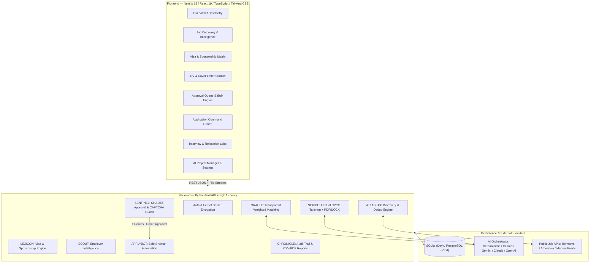

# APPLY
### Autonomous Personal Application & Recruitment Intelligence System

**APPLY** is a self-hosted, production-grade AI recruitment command centre designed to help international candidates discover global job opportunities, evaluate country-specific work visa and employer sponsorship rules, tailor factual CVs and cover letters, and manage human-approved job applications from a single cybersecurity-inspired operations dashboard.

---

## System Architecture



---

## Core Capabilities & 9-Agent Architecture

| Agent | Module | Core Responsibility |
| :--- | :--- | :--- |
| **ATLAS** | Job Discovery | Queries legal public APIs (Remotive, Arbeitnow) and manual feeds; enforces SHA-256 deduplication across Employer, Title, Location, and URL. |
| **ORACLE** | Matching Engine | Transparent weighted scoring (`Skills 30%`, `Experience 20%`, `Education 15%`, `Suitability 15%`, `Language 10%`, `Immigration 10%`). Caps overall score if a critical language or visa barrier is detected. |
| **LEXICON** | Visa Intelligence | Distinguishes UK Graduate Visa right-to-work (valid until **October 2027** without initial sponsorship) from post-2027 Skilled Worker transitions, Indian domestic citizen eligibility, and 20+ international work permit routes. |
| **SCRIBE** | CV & Cover Letter Studio | Parses `.pdf`, `.docx`, and `.txt` CVs; generates tailored CVs and STAR answers without fabricating experience; exports `.pdf` and `.docx`. |
| **SCOUT** | Employer Intelligence | Tracks company sponsor capabilities, hiring processes, source citations, and watchlists. |
| **APPLYBOT** | Automation Engine | Prepares application forms, maps fields, and executes approved submissions. |
| **SENTINEL** | Quality & Security Guard | Computes version-bound SHA-256 `approval_hash`. Automatically invalidates approval if answers or documents change after approval. Pauses immediately (`Needs human intervention`) if CAPTCHA or MFA is encountered. |
| **CHRONICLE** | Command Centre | Kanban board, table view, activity audit logs, and PDF/CSV executive reports. |
| **PROJECT MANAGER** | Engineering Telemetry | Live repository inspection, module tracker, security posture verification, and roadmap status. |

---

## Quick Start (Local Windows / macOS / Linux)

### 1. Backend Setup (FastAPI)
```powershell
cd D:\apply\backend
python -m pip install -r requirements.txt
$env:PYTHONPATH="."
python -m uvicorn app.main:app --host 127.0.0.1 --port 8000 --reload
```
- Interactive OpenAPI Docs: `http://localhost:8000/docs`

### 2. Frontend Setup (Next.js)
```powershell
cd D:\apply\frontend
npm install
npm run dev
```
- Command Centre UI: `http://localhost:3000`

### 3. Run Automated Verification & Security Test Suite
```powershell
cd D:\apply\backend
$env:PYTHONPATH="."
python -m pytest -v
```

### 4. Docker Deployment
```bash
docker compose up --build -d
```

---

## Security, Privacy & Factual Integrity Guarantees

- **Never Submits Unapproved Applications**: Every application requires explicit human approval tied to a cryptographic SHA-256 digest of the job, CV version, cover letter version, and form answers.
- **Zero Fabrication Policy**: Hospitality experience (Travelodge UK) is strictly maintained as customer-facing/operational experience and never misrepresented as commercial cybersecurity experience.
- ** clearly Labelled Demo Data**: Reference sandbox vacancies are visibly prefixed with `[DEMO]` so they are never confused with live applications.
- See [SECURITY.md](SECURITY.md) and [PRIVACY_AND_BACKUP.md](PRIVACY_AND_BACKUP.md) for full details.
